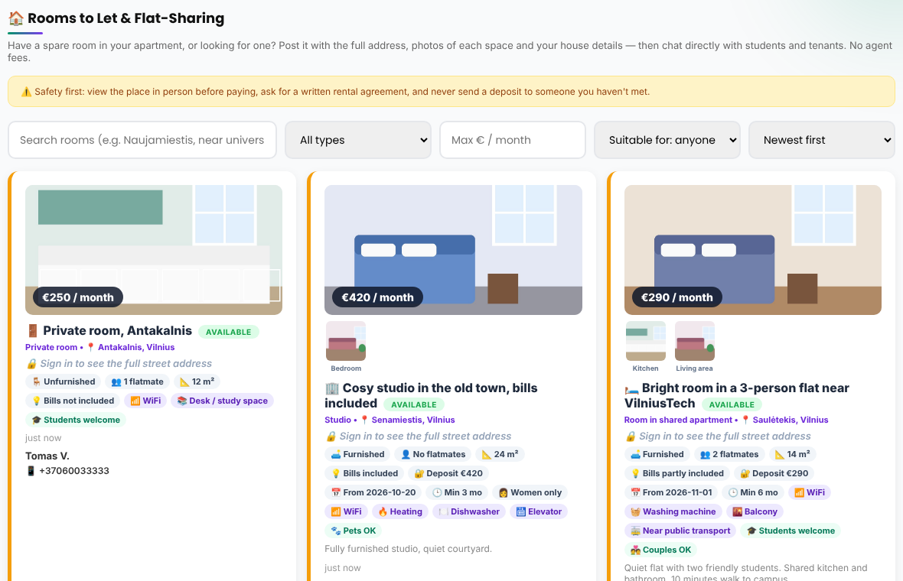
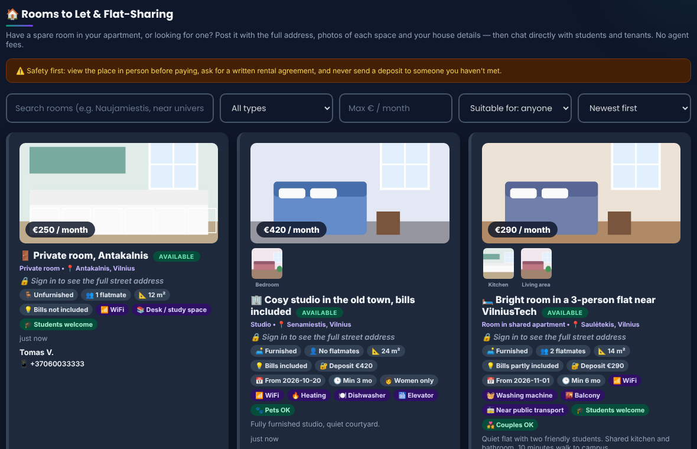
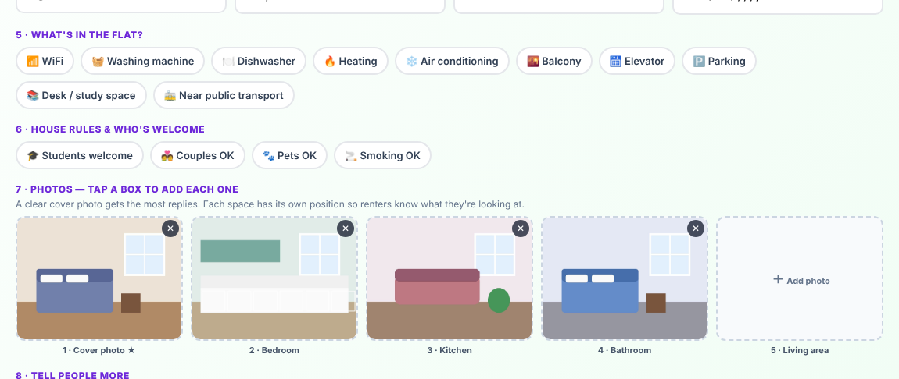
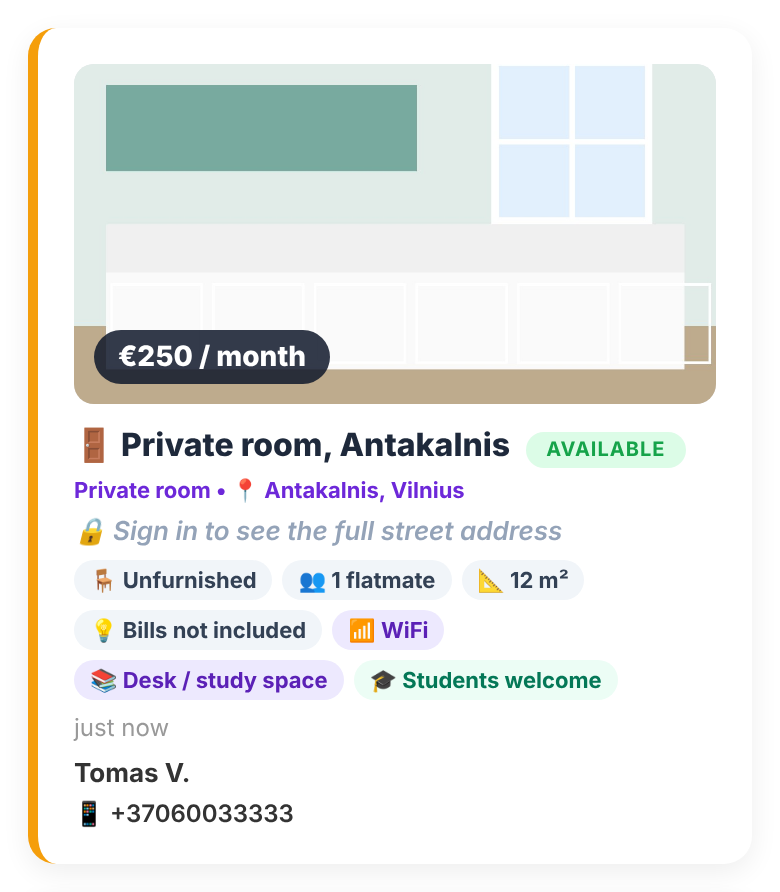

<p align="center">
  
</p>

<h1 align="center">GlobalRate</h1>
<p align="center"><b>Live currency rates · peer-to-peer money exchange · rooms to let · gadgets · rentals</b><br>
A free community marketplace for students and expats — built by <b>MightSmith</b> in Vilnius 🇱🇹</p>

<p align="center">
  <a href="https://www.globalrate.space"><b>🌍 Live site: www.globalrate.space</b></a>
</p>

<p align="center">
  
</p>

---

## What is GlobalRate?

Moving abroad means exchanging money, finding a room, buying a phone and getting around — usually through scattered Facebook groups and WhatsApp chats. **GlobalRate puts it all in one place**, with real accounts, built-in chat and no agent fees.

### Features

- 💱 **Peer-to-peer money exchange** — post what you have and what you need (e.g. EUR → USD) and meet someone nearby who wants the opposite.
- 📈 **Live rates & converter** — world currency rates with a fast converter.
- 🏠 **Rooms to let & flat-sharing** — room type, price, deposit, bills, flatmates, gender preference, minimum stay, amenities and house rules. Up to 5 **labelled photo slots** (cover, bedroom, kitchen, bathroom, living area). The **full street address is hidden until a user signs in**.
- 📱 **Items & gadgets** — sell phones, laptops and more with multiple photos.
- 🚗 **Car, taxi & e-bike rentals** — list or find local rides.
- 🌐 **Remittance agents** — compare providers in a pop-up dialog with clickable links straight to each provider.
- 💬 **Per-listing chat & inbox** — message the poster directly; unread messages are tracked.
- 🔢 **Hero dashboard** — live listing counts per category and unread-message count, all clickable.
- 🔐 **Accounts** — bcrypt-hashed passwords, welcome email, and a friendly **forgot-password** flow by email.
- 🛠️ **Admin panel** — stats, activity feed, users, listings, backup & restore, manual reset-link button.
- 🌙 **Dark / light mode** and a **mobile-first layout**.

## Screenshots

> Screenshots use demo data.

**Rooms to let** — address stays locked for visitors, photos are labelled per space.

| Light | Dark |
|---|---|
|  |  |

**Posting a room** — amenities and labelled photo slots.

| Post form | On a phone |
|---|---|
|  |  |

**Items & gadgets**

| Light | Dark |
|---|---|
|  |  |

## Tech stack

- **Backend:** Node.js + Express (single `server.js`)
- **Frontend:** vanilla HTML/CSS/JS (`public/index.html`, `public/admin.html`) — no build step
- **Storage:** JSON file database + uploads folder (PostgreSQL planned)
- **Auth & email:** bcryptjs, bearer-token sessions, Nodemailer (SMTP)
- **Hosting:** Render

## Run locally

```bash
git clone https://github.com/mightysamsonakor-glitch/globalrate.git
cd globalrate
npm install
cp .env.example .env   # then edit values (optional for basic use)
npm start
```

Open http://localhost:3000.

## Configuration

Set these in `.env` locally, or as environment variables on your host.

| Variable | Purpose |
|---|---|
| `PORT` | Server port (default 3000) |
| `BASE_URL` | Public site URL, used in emails and reset links (e.g. `https://www.globalrate.space`) |
| `DB_PATH` | Database file location (e.g. `/var/data/db.json` on a persistent disk) |
| `UPLOADS_DIR` | Photo storage folder (e.g. `/var/data/uploads`) |
| `SMTP_HOST`, `SMTP_PORT`, `SMTP_USER`, `SMTP_PASSWORD` | Outgoing email (welcome + password reset) |
| `ADMIN_EMAILS` | Comma-separated emails allowed into the admin panel |
| `ADMIN_KEY` | Secret key required for admin access |
| `SESSION_IDLE_DAYS` | Days of inactivity before a user is signed out (default 30, sliding) |
| `ADMIN_IDLE_MINUTES` | Minutes of inactivity before admin powers lock again (default 30) |

## Password reset

Users click **Forgot password?**, receive an email with a one-hour link, and set a new password. Tokens are stored hashed, requests are rate-limited, and admins can generate a reset link manually from the admin panel if email is unavailable.

## Admin panel

Visit `/admin.html` while signed in with an email listed in `ADMIN_EMAILS`, then enter `ADMIN_KEY`. Repeated wrong keys trigger a temporary lockout. From there you can view stats and activity, manage users and listings, and download or restore a full backup.

## Deploying on Render

1. Create a **Web Service** from this repo (build `npm install`, start `npm start`).
2. Add the environment variables above.
3. **Free plan:** the disk is wiped on every restart and SMTP is blocked — fine for testing only.
4. **Paid plan (recommended):** add a **Disk** mounted at `/var/data`, then set `DB_PATH=/var/data/db.json` and `UPLOADS_DIR=/var/data/uploads`. Data now survives restarts and deploys, and email works.
5. Confirm the logs show `Database file: /var/data/db.json`.

## Project structure

```
server.js            Express API, auth, email, admin routes
public/index.html    Main single-page app
public/admin.html    Admin panel
docs/screenshots/    README images
.env.example         Configuration template
```

## Roadmap

- [ ] PostgreSQL storage
- [ ] Language switch (English / Lithuanian)
- [ ] Favourites & report listing
- [ ] Exchange-rate alerts
- [ ] Featured listings
- [ ] "Looking for a room" board

## Contact

Built by **MightSmith** (Mighty Samson) — 3rd-year student at VilniusTech.
Questions or feedback: **admin@globalrate.space**

## License

Released under the MIT License.
