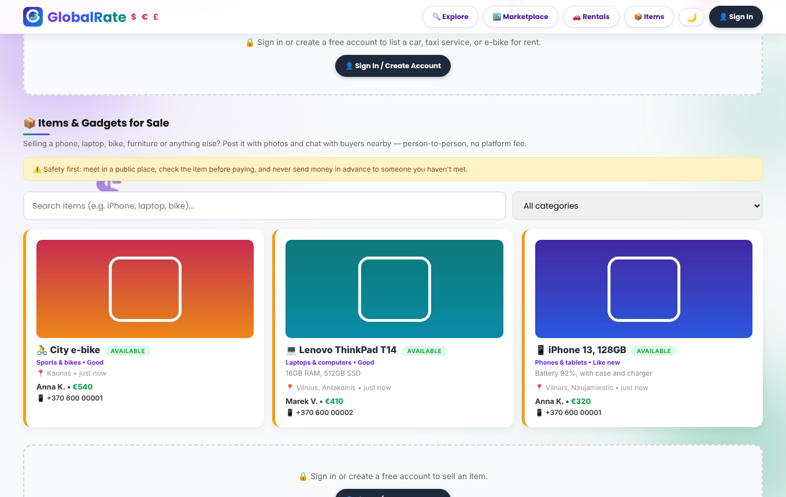
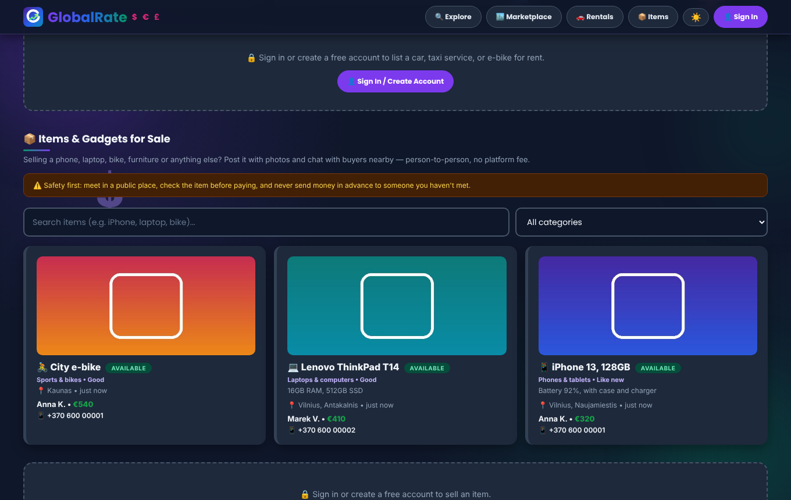

<p align="center">
  
</p>

<h1 align="center">GlobalRate</h1>
<p align="center"><b>Live world currency rates · remittance agents · a local peer-to-peer marketplace</b><br>
Built by <b>MightSmith</b> — inspired by everyday life in Lithuania 🇱🇹</p>

<p align="center"><a href="https://www.globalrate.space">www.globalrate.space</a></p>

---

## What is GlobalRate?

GlobalRate is a full-stack web app that helps people move, exchange and trade money and things locally:

- **💱 Live rates & converter** — 20+ currencies (USD, EUR, GBP, CAD, AUD, CNY, JPY, INR, TRY, …) refreshed from a public rates API, with a ticking live feed and a cross-rate table.
- **🌍 Remittance agents** — compare transfer apps (Wise, Remitly, WorldRemit, MoneyGram, …) by country.
- **🤝 P2P currency exchange** — people post "I have € / I want $" listings with phone number and Available / Taken / Sold status.
- **🚗 Rentals** — cars, taxi services, e-bikes and e-scooters rented person-to-person.
- **📦 Items & gadgets** — sell phones, laptops, furniture and more, **with photos**, categories, search and filters.
- **💬 Built-in chat** — logged-in users message each other about any listing; inbox included.
- **🔐 Accounts** — sign up / log in (bcrypt-hashed passwords) and an automatic welcome email.
- **🛡️ Owner admin panel** — stats, activity log, user & listing moderation, backup / restore.
- **🌗 Dark & light mode** — follows the device, remembers the choice.

## Screenshots

| Light | Dark |
|---|---|
|  |  |

## Tech stack

| Layer | Tech |
|---|---|
| Server | Node.js, Express |
| Frontend | One self-contained HTML/CSS/JS page (no build step) |
| Data | JSON-file database (`data/db.json`) + photo files (`data/uploads`) |
| Auth | bcryptjs password hashing, bearer session tokens |
| Email | Nodemailer + Zoho Mail SMTP |
| Rates | open.er-api.com (no API key) |

## Run it locally

```bash
git clone https://github.com/<your-username>/globalrate.git
cd globalrate
npm install
cp .env.example .env      # Windows: copy .env.example .env  — then fill it in
npm start
```

Open <http://localhost:3000>.

## Configuration (`.env` / host environment variables)

| Variable | Purpose |
|---|---|
| `SMTP_HOST`, `SMTP_PORT`, `SMTP_USER`, `SMTP_PASSWORD` | Welcome-email sender (optional) |
| `ADMIN_EMAILS` | Comma-separated emails allowed into `/admin.html` |
| `ADMIN_KEY` | Secret passphrase typed once to unlock admin powers |
| `PORT` | Set automatically by most hosts |
| `DB_PATH`, `UPLOADS_DIR` | Where data is stored — point both at a persistent disk in production |

## Owner admin panel

1. Create an account on the site using an email listed in `ADMIN_EMAILS`.
2. Open `/admin.html` (or the **🛡️ Admin** button) and enter your `ADMIN_KEY`.
3. You get: overview stats and 14-day chart, a live activity log (sign-ups, logins, failed logins, posts, removals), user management, listing moderation (also available as **Remove (admin)** buttons on the public page), and **full backup / restore** (database + photos).

Security notes: admin routes need *both* an allowed email *and* the secret key, the key check is rate-limited, passwords are hashed, and `.env` is git-ignored.

## Deploying (Render example)

1. Push this repo to GitHub.
2. Render → **New → Web Service** → pick the repo. Build: `npm install` · Start: `npm start`.
3. Add the environment variables above.
4. Add your custom domain under **Settings → Custom Domains** and create the DNS records Render shows.
5. **Free plan:** disk is wiped on restart — download a backup from the admin panel regularly.
   **Paid plan:** attach a disk (e.g. mount `/var/data`) and set `DB_PATH=/var/data/db.json`, `UPLOADS_DIR=/var/data/uploads`.

## Roadmap

- [ ] Move from the JSON file to PostgreSQL
- [ ] Email verification & password reset
- [ ] Lithuanian / English language switch
- [ ] Favourites and "report listing"
- [ ] Rate alerts by email

## License

Personal project © MightSmith. All rights reserved unless a license file says otherwise.
